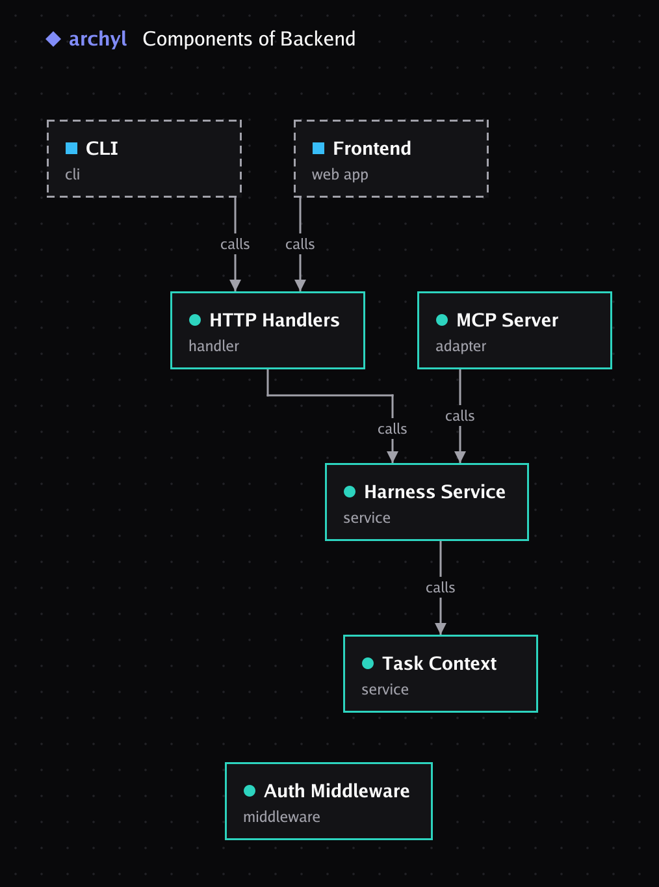

# archyl

[](https://github.com/archyl-com/cli/actions/workflows/ci.yml)
[](https://github.com/archyl-com/cli/releases)
[](https://pkg.go.dev/github.com/archyl-com/cli)
[](LICENSE)

```
   ▄██▄
  ▄▄▄▄▄▄     archyl
  ▀▀  ▀▀     Your architecture, in the terminal
 ██▄▄▄▄██    and in your coding agents.
▄▄▄▄  ▄▄▄▄
▀▀▀▀  ▀▀▀▀
```

`archyl` connects a repository to its architecture in [Archyl](https://archyl.com).
Explore the C4 model in a full-screen view, see what your branch affects and who
to tell, gate pull requests on your architecture rules and technology radar,
brief coding agents before they touch code, and guard what they write.

**[Documentation](https://archyl.com/docs/guides/cli)** ·
[Changelog](CHANGELOG.md) · [Contributing](CONTRIBUTING.md) · [Security](SECURITY.md)


## Install

```sh
# Homebrew (macOS, Linux)
brew install archyl-com/tap/archyl

# Install script (macOS, Linux), checksum verified
curl -fsSL https://raw.githubusercontent.com/archyl-com/cli/main/install.sh | sh

# PowerShell (Windows), checksum verified
irm https://raw.githubusercontent.com/archyl-com/cli/main/install.ps1 | iex

# Go
go install github.com/archyl-com/cli/cmd/archyl@latest
```

Or download a binary from the [releases](https://github.com/archyl-com/cli/releases).
Archives are checksummed, signed with [cosign](https://github.com/sigstore/cosign)
and ship with an SBOM.

## Get started

```sh
archyl login          # sign in through your browser
archyl init           # link this repository to its Archyl project (.archyl.json)
                      # no project yet? archyl init --new creates one and discovers it
archyl setup          # connect Claude Code, Cursor, VS Code or Codex
```

Then run `archyl` on its own for a session: ask about the architecture in plain
language — the assistant runs `impact`, `check`, `brief` and the rest right here
when it needs to, showing each one — or type `/` for commands, `@` to attach a
file, `#` for elements. Enter sends, shift+enter starts a new line, and
`archyl -c` picks up where you left off.

```console
› which elements does my branch touch, and who should I tell?
  ⏺ archyl impact
  Your branch changes Payments, which Checkout Web calls. Tell @payments.
```

`archyl init` picks the project for you when the repository's remote is connected
to it in Archyl. When none is, `archyl init --new` starts one: it creates the
project, connects the repository from its git remote, runs an AI discovery while
you watch, lets you triage what it found, draws the result and offers `setup`
(`--yes` takes every default). Commit `.archyl.json`: it holds no secret, and your team and CI
then share the link. `archyl doctor` checks the whole setup and says how to fix
what is not right.

## Commands

### Explore


| Command | What it does |
| --- | --- |
| `archyl` | A session: ask in plain language (the assistant runs commands for you, asking before anything that writes), or `/impact`, `/run`, `/map`… `@file` attaches a file, `#element` points at one, shift+enter starts a new line. `archyl -c` picks up the last conversation, `/resume` an earlier one. |
| `archyl activity [-f]` | One feed of what happens: model changes, change requests, agent runs and sessions. `--follow` like `tail -f`, `--notify` when an agent waits for you. |
| `archyl map [element]` | Full-screen C4 explorer: tree, details, relationships both ways, blast radius, fuzzy filter, open in the web app. `d` switches to the level's diagram: tab selects, enter drills down, backspace goes up. |
| `archyl diagram [element]` | A C4 diagram: the system context, or centred on any element (system, container, component or code) and its neighbours; `--inside` shows a system's containers or a container's components. An image in Kitty, Ghostty, WezTerm and iTerm2, box-drawing text elsewhere; `--format png\|svg\|mermaid` or `-o file.png`. |
| `archyl tour [element]` | A guided walk through the codebase for newcomers: the systems or containers to meet first, in the order work flows, with a story written by AI from the model and, for each stop, its owners, the files to read first, its decisions, pitfalls and rules. `--no-ai` for facts only, `--markdown > ONBOARDING.md` with diagrams. |
| `archyl history [from..to] [element]` | How the architecture changed between two points (versions, releases, dates, `30d..`): elements and relationships added, removed and modified, and a diagram with the changes marked. Markdown for release notes when piped, `--markdown` with a Mermaid diagram, `-o changes.png`, `--json`; `--play` replays every version full screen, like the web app's time-lapse. |
| `archyl incident <element>` | One read-only screen for an element in trouble: owners, who depends on it and what it depends on, recent changes and releases, linked docs, decisions and pitfalls, everyone to tell. `--slack` prints a message for the incident channel, `--copy` puts it on the clipboard. |
| `archyl decide ["what was decided"]` | Drafts an ADR from your branch's changes with Archyl's AI; you review or edit it in `$EDITOR`, and it is recorded as proposed and linked to the elements it is about. `--no-ai` starts from a template. |
| `archyl codeowners` | Generates the CODEOWNERS block from the owners recorded in Archyl and the folder each element lives in; `--write` updates the file, `--check` fails CI when it is out of date. |
| `archyl search [query]` | Live search across elements, decisions, docs and contracts, with a preview. |
| `archyl show <element \| ADR-n>` | An element with its relationships, decisions and blast radius, or a rendered decision. |
| `archyl where <path>…` | The C4 element a file belongs to, its owners and what depends on it. |
| `archyl why <file[:line]>` | git blame for the architecture: the file's elements, the decisions that apply, owners, what was remembered, the rules aimed at it, recent model changes, and the commit behind the line tied to the decisions made around it. |
| `archyl impact` | Everything your branch changes, traced to what depends on it, with the owners to notify. `--diagram` draws it, touched elements highlighted. |
| `archyl ask "<question>"` | Ask the AI assistant; the answer renders as it streams. Pipe a diff in for context. |
| `archyl adr` / `adr new` | List decisions, or record one through a form. |
| `archyl discover` | Runs an AI discovery on the linked repositories and follows it; `discover review` approves or rejects what it found, one by one or all at once. Each repository counts as one discovery. |
| `archyl status` | One screen: alignment, your branch, the agents at work. |
| `archyl open [element \| ADR-n]` | Open the project, an element or a decision in the web app. |
| `archyl context` | The architecture as markdown tuned for AI agents. |


### Coding agents

| Command | What it does |
| --- | --- |
| `archyl setup` | Configures Claude Code, Cursor, VS Code and Codex to use Archyl's MCP server, installs the Guard hook and the status line, teaches the agents the CLI in `CLAUDE.md` / `AGENTS.md`, and offers shell completion. |
| `archyl plan "<task>"` | An implementation plan grounded in the architecture: steps, elements, decisions, what past sessions learned. |
| `archyl brief [files]` | What to know before editing these files: elements, dependents, decisions, owners, remembered pitfalls. |
| `archyl remember` / `recall` | Teach Archyl what the code cannot show, on the element it is about; find it again later. |
| `archyl agents` | Live view of the agents at work: tasks, leased elements, collisions, files changed. |
| `archyl runs` | Managed agent runs: follow one live, answer its questions, review its plan, steer, cancel, continue. Every action also exists as a command. |
| `archyl mcp` | Archyl's MCP tools over stdio, signed in as you: one `archyl login` connects every agent. |
| `archyl wrap -- <agent>` | Runs an agent inside a work session: briefing in, heartbeats while it works, changed files out, optional draft change request. |
| `archyl fix` | Hands the branch's rule violations to Claude Code or Codex under the harness, with the brief and decisions around them, then checks again: "3 violations → 0". Never commits; `--print` writes the task for any agent. |
| `archyl lsp` | A language server: violations as diagnostics on save, the file's element on hover, "Ask Archyl why" and "Open in Archyl" code actions. Setup for VS Code, Neovim, Zed and Helix in [docs/lsp.md](docs/lsp.md). |
| `archyl guard` | The PreToolUse hook: blocks edits that break the architecture rules or add a dependency the radar puts on hold. |
| `archyl statusline` | A status line for Claude Code: project and work session. |
| `archyl session …` | The work-session protocol by hand: `list`, `start`, `heartbeat`, `finish`, `cancel`. |

### Checks and CI


| Command | What it does |
| --- | --- |
| `archyl rules` | Lists the architecture rules that apply to the project, most severe first. |
| `archyl projects` | Lists the projects you can reach and marks the one this repository is linked to. |
| `archyl check` | Runs the conformance rules on every changed file. Annotations on GitHub, a Code Quality report on GitLab, SARIF anywhere; exits 1 at `--fail-on`. |
| `archyl review` | Before the pull request: violations, touched elements and their dependents, who to notify, the alignment score. `--comment` keeps one up-to-date comment on the GitHub or GitLab request, with a Mermaid diagram of the impact; `--diagram` prints it locally. |
| `archyl radar` / `radar check` | The technology radar by ring, and a check of this repository's dependencies against it. |
| `archyl cr` | List, read, approve or request changes on Architecture Change Requests. |
| `archyl hooks install` | A `pre-push` hook that blocks critical violations, and lets the push through when Archyl is unreachable. |
| `archyl drift` | Model-to-code alignment score; `--compute --fail-under 80` as a quality gate. |
| `archyl dsl pull` / `diff` / `push` | Architecture as code: write the model to `archyl.yaml`, see what pushing it would change by C4 level, push it. Push never deletes. `archyl sync` is `dsl push`. |
| `archyl release` | Records a release, versioned from the CI tag. |

### Account and shell

| Command | What it does |
| --- | --- |
| `archyl login` / `logout` | Browser sign-in (OAuth 2.1 + PKCE), stored in the OS keychain, refreshed automatically. |
| `archyl doctor` | Checks your setup end to end and prints the fix for each problem. |
| `archyl inbox` | Mentions, reviews, agent runs and tasks — pick one to act on it. `--watch` for desktop notifications. |
| `archyl whoami` | Who you are, on which host, organization and project. |
| `archyl cache clear` | Drops the local copy of the model that `map`, `show` and completion answer from. `--no-cache` skips it for one command. |
| `archyl profile` | Switch between Archyl instances or organizations: `archyl profile use work`. |
| `archyl prompt` | A few characters for your shell prompt, served from cache. |
| `archyl upgrade` | Upgrades the way you installed: `brew upgrade` for Homebrew, the `go install` command for Go, otherwise in place with the release archive, checksum verified (and its cosign signature when `cosign` is on your `PATH`). `--check` only reports. |
| `archyl completion install` | Installs Tab completion for bash, zsh, fish or PowerShell where your shell loads it; `archyl setup` offers it too. |

Every command takes `--json` for scripts, and `--project` to override `.archyl.json`.
Element names complete with Tab.

### Diagrams

`archyl diagram` draws the system context by default. Name an element of any
level and the diagram is centred on it, with its neighbours; `--inside` draws
the level inside it instead, with the elements around dashed. In Kitty,
Ghostty, WezTerm and iTerm2 it is an image; in other terminals and in pipes it
is text:

```
 ┌─────────────────┐   ┌╌╌╌╌╌╌╌╌╌╌╌╌╌╌╌╌╌┐   ┌╌╌╌╌╌╌╌╌╌╌╌╌╌╌╌╌╌┐
 │ ▣ Storefront    │   ╎ ◆ Warehouse     ╎   ╎ ◆ Mailgun       ╎
 │ web app · React │   ╎ software system ╎   ╎ software system ╎
 └────────┬────────┘   └╌╌╌╌╌╌╌╌┬╌╌╌╌╌╌╌╌┘   └╌╌╌╌╌╌╌╌╌╌╌╌╌╌╌╌╌┘
          │                     │
          └───────────────┐     │ updates stock
         places orders ×2 │     │
                          ▼     ▼
                    ┌─────────────────┐
                    │ ▣ Shop API  4 ◉ │
                    │ api · Go        │
                    └─────┬─────┬─────┘
            charges cards │     │ reads from ×2
                          ▼     ▼
```

```sh
archyl diagram Checkout                  # centred on one element, any level
archyl diagram "Orders DB" --depth 2     # and two hops around it
archyl diagram Shop --inside             # the containers of the Shop system
archyl diagram "Shop API" -o shop.png    # -o picks the format: .png .svg .mmd .md .txt
archyl diagram --format mermaid > c4.mmd
archyl impact --diagram                  # what your branch touches, highlighted
archyl review --diagram                  # the same impact as a Mermaid flowchart
```


`-o` writes a view as an image, here `archyl diagram Backend --inside -o diagram.png`:



Inside tmux, images need `set -g allow-passthrough on`; `ARCHYL_IMAGES=0`
always draws text.

## Built for coding agents

Agents run the CLI from their shell. Every command an agent uses (`plan`,
`brief`, `recall`, `impact`, `check`) prints compact markdown when it is not in
a terminal, and `--json` everywhere else. `archyl setup` writes a short block
into `CLAUDE.md` / `AGENTS.md` telling the agent when to run which command, and
the Guard hook stops edits that break the rules or add a dependency on hold.

## Coding agents under the harness

```sh
archyl setup                                   # once per repository
archyl wrap -- claude                          # asks what the task is
archyl wrap --task "Add PDF export" -- claude
```

`wrap` opens a work session for the task. Archyl picks the relevant elements,
decisions and rules, leases the elements so two agents do not collide, and
returns a briefing. Claude Code receives it as an appended system prompt; any
agent finds it in `$ARCHYL_BRIEFING_FILE`. While the agent works, the session
is kept alive and the Guard hook attributes each edited file to it. When the
agent exits, `wrap` reports what changed, closes the session and offers to open
a draft Architecture Change Request so a human reviews how the model should
catch up.

If Archyl is unreachable, `wrap` warns and runs the agent anyway.

`archyl fix` puts the same harness to work on the branch's rule violations: it
runs the check, lets you pick the violations, and hands each one (rule,
severity, location, suggestion) to the agent along with the brief of the
elements involved and the decisions that apply. When the agent exits it checks
again and shows what is left. Nothing is committed.

The MCP configuration `setup` writes holds only the server URL: each agent signs
in through Archyl itself, so the files are safe to commit.

## CI and scripts

On GitHub, the action installs the CLI and runs a command:

```yaml
permissions:
  contents: read
  pull-requests: write
steps:
  - uses: actions/checkout@v4
    with:
      fetch-depth: 0
  - uses: archyl-com/cli@v1
    with:
      api-key: ${{ secrets.ARCHYL_API_KEY }}
      command: review --comment
```

Anywhere else:

No login needed: set an API key (Archyl › Settings › API keys).

```sh
export ARCHYL_API_KEY=arch_…
export ARCHYL_PROJECT_ID=…       # or commit .archyl.json
archyl check                     # fails the job on high violations
archyl impact --json | jq '.impact.notify'
archyl dsl diff --exit-code      # fails when archyl.yaml and the model differ
```

`archyl check` and `archyl review` compare with the pull request's target branch
on GitHub Actions, GitLab CI, Bitbucket Pipelines and Azure Pipelines. CI
checkouts are often shallow: fetch the history (`fetch-depth: 0` on GitHub,
`GIT_DEPTH: 0` on GitLab).

```yaml
# .gitlab-ci.yml
archyl:
  variables:
    GIT_DEPTH: 0
  script:
    - archyl check
  artifacts:
    reports:
      codequality: gl-code-quality-report.json
```

| Variable | Purpose |
| --- | --- |
| `ARCHYL_API_KEY` | API key; skips stored credentials |
| `ARCHYL_HOST` | API URL for self-hosted Archyl (default `https://api.archyl.com`). `ARCHYL_API_URL` is also read. A stored sign-in is only sent to the host it was made on: for another host, run `archyl login --host` or set `ARCHYL_API_KEY` |
| `ARCHYL_PROJECT_ID` | Project, overriding `.archyl.json` |
| `ARCHYL_ORG_ID` | Organization |
| `ARCHYL_PROFILE` / `--profile` | Profile to use |
| `ARCHYL_GUARD_BLOCK` | `critical` (default), `high` or `off` |
| `ARCHYL_CONFIG_DIR` | Configuration directory |
| `ARCHYL_CACHE_DIR` | Cache directory |
| `ARCHYL_NO_CACHE` | `1` to never use the local model cache |
| `ARCHYL_NO_KEYRING` | Store credentials in a 0600 file instead of the OS keychain |
| `ARCHYL_APP_URL` | Web app URL, when it is not the API host with `api.` replaced by `app.` |
| `ARCHYL_IMAGES` | `0` to draw diagrams as text even where the terminal shows images |
| `ARCHYL_THEME` | `dark` or `light`, to skip asking the terminal for its background |
| `ARCHYL_NO_UPDATE_NOTIFIER` | Never mention new releases |
| `GITHUB_TOKEN`, `GITLAB_TOKEN`, `ARCHYL_GITLAB_TOKEN` | Token `review --comment` posts with |
| `NO_COLOR` | Plain output |

## Self-hosted Archyl

```sh
archyl login --host https://archyl.example.com --profile work
```

The CLI needs an Archyl release that ships its endpoints (file location,
DSL diff, project discovery, OAuth refresh tokens, tool calls in the chat).
`archyl doctor` tells you when the instance is too old for a command, and
the commands that depend on a missing endpoint say so instead of failing
silently.

## Development

```sh
go test ./...
go run ./cmd/archyl --help
```

Output follows two rules: status and spinners go to stderr, results to stdout;
and every command that prints something useful has a `--json` form. See
[CONTRIBUTING.md](CONTRIBUTING.md) for the conventions and the layout, and
[SECURITY.md](SECURITY.md) to report a vulnerability or verify a release.

## License

[MIT](LICENSE)
